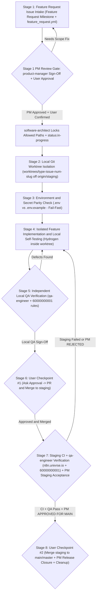

# UniVRse Workflow — Unified Cross-Harness Agent & Delivery Specification

> **Canonical Source of Truth**: This file (`AGENTS.md`) is the single source of truth for **Claude Code** (`CLAUDE.md -> AGENTS.md`), **OpenAI Codex** (`AGENTS.md`), and **Google Antigravity / Gemini CLI** (`GEMINI.md -> AGENTS.md`) operating inside `/Users/brendonang/Desktop/UniVRse workflow`.
>
> **Repo Domain Reference Preserved**: Repository-specific runtime rules, Hani/Hermes bridge constraints, Stark 1 Lock Sync rules, and SLA floors live in [`./UniVRse-2.0/CLAUDE.md`](./UniVRse-2.0/CLAUDE.md) (**Jarvis Operating Manual**) and MUST be honored alongside this workspace specification.

---

## 1. Workspace Scope, Repository Layout & Domain Locks

### 1.1 Workspace & Primary Repository Layout
- **Workspace Root**: `/Users/brendonang/Desktop/UniVRse workflow`
- **Primary Repository**: `/Users/brendonang/Desktop/UniVRse workflow/UniVRse-2.0`
  - **Git Remote (`origin`)**: `https://github.com/UniVRse-Interactive/UniVRse-OS.git`
  - **Production Branch Note**: `origin/master` is currently the repository's production branch (`origin/HEAD -> origin/master`). The `staging` branch must be bootstrapped from `origin/master` (or `origin/main` if renamed) per Stage 2 before opening feature PRs.
- **Issue Tracking Policy**: **GitHub Issues ONLY** (`gh issue` CLI and `github` MCP) on `UniVRse-Interactive/UniVRse-OS`. **No external issue trackers** exist in `UniVRse workflow`; all new features open under Milestone **`Feature Request`** using `.github/ISSUE_TEMPLATE/feature_request.yml`.

```text
/Users/brendonang/Desktop/UniVRse workflow/
├── AGENTS.md                   # Canonical cross-harness workflow & orchestration spec
├── CLAUDE.md -> AGENTS.md      # Relative symlink for Claude Code
├── GEMINI.md -> AGENTS.md      # Relative symlink for Google Antigravity / Gemini CLI
├── .agents/                    # Workspace specialist agent roster (10 agents) & MCP config
├── .github/ISSUE_TEMPLATE/     # Feature Request GitHub Issue template (feature_request.yml)
├── .mcp.json                   # Unified workspace MCP server definitions
└── UniVRse-2.0/                # Primary repo (UniVRse-Interactive/UniVRse-OS.git)
    ├── CLAUDE.md               # PRESERVED: Jarvis Operating Manual & Stark 1 Lock Sync
    ├── .env.example            # Canonical list of environment keys (secrets in .env)
    ├── .gitignore              # Must include worktrees/ (never commit worktrees or .env)
    ├── hermes/bridge/          # Hani-Hermes Python bridge (hani_bridge.py, link_ingest.py)
    ├── tools/                  # Python tools (gcal_direct.py, tenant_gate.py, etc.)
    ├── workflows/              # Markdown SOPs & n8n workflow blueprints
    ├── tests/                  # Python test suites & smoke harnesses
    └── worktrees/              # Gitignored isolated local worktrees (<type>-issue-<num>-<slug>)
```

### 1.2 Repo-Level Domain Reference (`./UniVRse-2.0/CLAUDE.md`)
Whenever working inside `UniVRse-2.0/`, agents MUST read and preserve [`./UniVRse-2.0/CLAUDE.md`](./UniVRse-2.0/CLAUDE.md) (**Jarvis Operating Manual with Stark 1 Lock Sync**). Do not overwrite or bypass these domain locks:

1. **Four-Lane Architecture**:
   - **STARK** (Strategy / Race Director), **JARVIS** (n8n logic, Hani's brain, RAG thresholds, workflow architecture), **ULTRON** (VPS chassis `207.148.76.194` / Tailscale `100.81.157.49`, Docker, Supabase SQL, cron, service restarts), **HANI ALYSSA** (runtime agent), and **HEZRI** (Team Principal / final decision maker).
2. **Hani / Hermes Bridge & Frozen Chassis Locks**:
   - **Hermes-only main brain pipeline (`run_brain()`)**: Primary service `hani-hermes-bridge.service` at `http://172.18.0.1:5057/hani`, `_call_hermes()` timeout cap `min(effective_timeout, 50)`, outer watchdog `55s`, no `openai_direct` or Claude fallback on the T0/T1 main pipeline (multi-tenant flow uses `_run_tenant_flow()` / `_call_openai_tenant()`).
   - **Frozen n8n chassis (`An5boYbCZW5BaPse`)**: 68-node base / 71 live nodes frozen per Stark directive. Do not add unauthorized n8n nodes; route new coordination hooks via the Python bridge or direct webhooks. Preserve `shortMessage` guard (`clean.length <= 80`), `isYes` regex, `[Hermes Hani]` prefix rule, Calendar direct bypass (`tools/gcal_direct.py`), and Drive rank filters (`_drive_name_score()`).
3. **N8N Lane Separation (CRITICAL)**:
   - **PROD lane**: `https://n8n-prod.univrse.io` (port `5679`, container `n8n-leaf`, WhatsApp `1gd6dLcn0Es21yNl`, Telegram `XN0H3Xu20vEs8TDI`).
   - **STAGING lane**: `https://n8n.univrse.io` (port `5678`, container `n8n`).
   - Never modify `/etc/nginx/sites-available/n8n` or `/etc/nginx/sites-available/n8n-prod` without explicit written directive from Stark AND Hezri.
4. **RAG Thresholds & SLA v2.1 Enforcement Locks**:
   - **Similarity thresholds**: General KB `0.65`, High-context `0.55`, Verification_Audit minimum `0.55`, `BLOCK_ALL_INFERENCE` `< 0.70`.
   - **SLA v2.1 latency floors**: Group A (Conversational) `4–7s`; Group B (KB Search bridge) `13.4s` (`16–19s` WA total); Group C (Email/Task/Delegation) `13.2s` ceiling (`~16–17s` WA total).
5. **Smoke Test Phone Protocol — ENFORCEMENT LOCKED**:
   - **ALL automated and manual internal smoke tests MUST use test phone `60000000001` exclusively.**
   - **Production line `60187777876` is strictly BANNED from any internal or automated test** (pollutes `sd.pendingHerHaniEmail` and `herhani_memory.json`).
6. **Precedence Rule**:
   - This root `AGENTS.md` governs cross-harness orchestration, subagent delegation, and the **8-Stage GitHub Issue -> Git Worktree -> `staging` -> `main` (`master`)** delivery pipeline (superseding raw direct pushes to `master`).
   - `./UniVRse-2.0/CLAUDE.md` governs all UniVRse runtime architecture, Hani/Hermes bridge behavior, thresholds, SLA floors, and smoke-test safety locks.

---

## 2. Unified Cross-Harness Compatibility (Claude Code + Codex + Antigravity)

### 2.1 Symlink & Harness Resolution
| Harness | Files Loaded Automatically | Role in `UniVRse workflow` |
| :--- | :--- | :--- |
| **OpenAI Codex** | `AGENTS.md` (workspace root) | Reads canonical spec directly; respects `UniVRse-2.0/CLAUDE.md` when scoped into `UniVRse-2.0/`. |
| **Claude Code** | `CLAUDE.md` (`-> AGENTS.md`) + `UniVRse-2.0/CLAUDE.md` | Root `CLAUDE.md` symlink loads this spec; `UniVRse-2.0/CLAUDE.md` appends domain locks inside the repo. |
| **Google Antigravity / Gemini CLI** | `GEMINI.md` (`-> AGENTS.md`) & `AGENTS.md` | Both resolve to this single canonical file; `.agents/agents/` supplies specialist subagent definitions. |

### 2.2 Cross-Harness Model & Subagent Mapping Table
The Main Session acts strictly as the **Lead Orchestrator** (intake, decomposition, contract definition, concurrent fan-out, and verification gates) and NEVER writes bulk application code directly when a specialist subagent applies.

| Complexity Tier | Specialist Roles | Google Antigravity (`swarm` / `invoke_subagent`) | Claude Code (`Agent` `model`) | OpenAI Codex (`reasoning_effort`) | Primary Scope |
| :--- | :--- | :--- | :--- | :--- | :--- |
| **Orchestration Tier** | Lead Orchestrator, `orchestrator` | **Gemini 4 Argon**<br>`gemini-4-argon-low\|medium\|high`<br>(`Model: "inherit"` + `Assigned Effort`) | **`opus`**<br>(`low` / `medium` / `high`) | **High-Reasoning Orchestrator**<br>(`reasoning_effort: high`) | Phase 0 triage, task-complexity effort assignment, decomposition, contract enforcement, PR/QA/PM gates |
| **Deep Thinking / PM / Architecture / Security Tier** | `product-manager`, `software-architect`, `security-engineer`, deep concurrency/root-cause debugger | **Gemini 4 Carbon**<br>`gemini-4-carbon-low\|medium\|high`<br>(`Model: "pro"` + `Assigned Effort`) | **`opus`**<br>(`low` / `medium` / `high`) | **`high` effort** | `Feature Request` Milestone triage & PM Review Gates (Stage 1/7/8), system architecture, GitHub Issue `Allowed Paths` decomposition, Stark 1 Lock reviews, RLS/IAM/webhook security audits, `staging -> main`/`master` release gate, concurrency debugging |
| **Everyday Implementation / QA / DevOps / Taskboard Tier** | `backend-engineer`, `frontend-engineer`, `devops-engineer`, `qa-engineer`, `auditor`, `taskboard-manager` | **Gemini 4 Hydrogen**<br>`gemini-4-hydrogen-low\|medium\|high\|xhigh`<br>(`Model: "flash_lite"` for `low`; `"flash"` for `medium`/`high`/`xhigh` + `Assigned Effort`) | **`haiku`** (`low`) / **`sonnet`** (`medium` / `high` / `xhigh`) | **`medium` / `high` effort** (`low` for trivial mechanical chores) | Feature/bug coding in worktrees, UI/API work, Docker/CI/VPS prep, unit/integration/QA suites, read-only audits, `gh issue` labels/milestones/hygiene |

#### `.agents/agents/` Specialist Roster (`10` Specialist Agents)
- **Orchestration Tier (1)**: `orchestrator` (**Gemini 4 Argon** / `opus` / Codex `high`)
- **Deep Thinking / PM / Architecture / Security Tier (3)**: `product-manager`, `software-architect`, `security-engineer` (**Gemini 4 Carbon** / `opus` / Codex `high`)
- **Everyday Implementation / QA / DevOps / Taskboard Tier (6)**: `backend-engineer`, `frontend-engineer`, `devops-engineer`, `qa-engineer`, `auditor`, `taskboard-manager` (**Gemini 4 Hydrogen** / `haiku`\|`sonnet` / Codex `low`–`high`)

### 2.3 Dynamic Effort Selection Matrix (`low` / `medium` / `high` / `xhigh`)
On every dispatch, the Lead Orchestrator evaluates task complexity and assigns **both** the **Model Tier** and the exact **Effort Level**:

| Tier & Agents | Effort | Antigravity `swarm` / `invoke_subagent` | Claude Code | Codex | Task Complexity Criteria |
| :--- | :--- | :--- | :--- | :--- | :--- |
| **Everyday Tier** (`backend-engineer`, `frontend-engineer`, `devops-engineer`, `qa-engineer`, `auditor`, `taskboard-manager`) | **`low`** | `gemini-4-hydrogen-low`<br>`Model: "flash_lite"` + `Effort: low` | `haiku` (`low`) | `low` | **Trivial / Mechanical**: GitHub issue labels/milestones (`taskboard-manager`), typo/copy fixes, single-value config tweaks, quick status checks |
| **Everyday Tier** | **`medium`** | `gemini-4-hydrogen-medium`<br>`Model: "flash"` + `Effort: medium` | `sonnet` (`medium`) | `medium` | **Routine Single-File**: Isolated 1-file bug fix, single route/UI tweak, running existing `unittest`/`pytest`/lint checks, single-file read-only check (`auditor`) |
| **Everyday Tier** | **`high`** | `gemini-4-hydrogen-high`<br>`Model: "flash"` + `Effort: high` | `sonnet` (`high`) | `high` | **Moderate Multi-File**: Standard feature across 2–4 files + new unit tests, CI/Docker/workflow updates, full Stage 5/7 `qa-engineer` verification |
| **Everyday Tier** | **`xhigh`** | `gemini-4-hydrogen-xhigh`<br>`Model: "flash"` + `Effort: xhigh` | `sonnet` (`high`) | `high` | **Complex Everyday Engineering**: Multi-module Hani-Hermes/Supabase/n8n wiring, complex SQL/RPC aggregations, full-repo read-only audit, or retry #1 after a `medium`/`high` failure |
| **Deep Thinking / PM / Architecture / Security Tier** (`product-manager`, `software-architect`, `security-engineer`) | **`low`** | `gemini-4-carbon-low`<br>`Model: "pro"` + `Effort: low` | `opus` (`low`) | `medium` | **Lightweight Review / Sync**: Routine Stage 8 PM release delivery closure on `Feature Request` Milestone issues, post-release GitHub Issue metadata verification, simple PR metadata check, single-endpoint auth header check |
| **Deep Thinking / PM / Architecture / Security Tier** | **`medium`** | `gemini-4-carbon-medium`<br>`Model: "pro"` + `Effort: medium` | `opus` (`medium`) | `high` | **Standard Complex**: Triaging 1–2 Feature Request issues (`Feature Request` Milestone, Gherkin ACs, Story Points, Stage 1 PM Review Sign-Off) or Stage 7 PM Staging Acceptance Review (`[PM APPROVED FOR MAIN]`), decomposing 1 GitHub Issue into `Allowed Paths` & contracts, reviewing a `<type>/issue-<num>-<slug> -> staging` PR, single-module RLS/webhook audit |
| **Deep Thinking / PM / Architecture / Security Tier** | **`high`** | `gemini-4-carbon-high`<br>`Model: "pro"` + `Effort: high` | `opus` (`high`) | `high` | **Deep Long-Horizon / Critical**: Full multi-feature product discovery & splitting `13`-point scopes into `<= 8` vertical slices, multi-module architecture, Stark 1 Lock Sync compliance design, full RLS/IAM threat modeling, `staging -> main`/`master` release sign-off, deep race-condition/concurrency debugging |
| **Orchestration Tier** (`orchestrator`) | **`low` / `medium` / `high`** | `gemini-4-argon-low\|medium\|high`<br>`Model: "inherit"` + `Effort: low\|medium\|high` | `opus` (`low`/`medium`/`high`) | `high` | **`low`**: Quick status synthesis; **`medium`**: Coordinating 2–3 subagents; **`high`**: Full end-to-end 8-stage GitHub Issue orchestration |

### 2.4 Progressive Escalation Ladder (`low -> medium -> high -> xhigh -> Carbon`)
1. **Intra-Tier Effort Escalation**: If an Everyday-Tier subagent at `low` or `medium` encounters unexpected complexity or fails verification once, immediately bump effort to `high` or `xhigh` on retry #1.
2. **Cross-Tier Escalation (`Hydrogen xhigh` -> `Carbon medium/high`)**: If an Everyday-Tier subagent at `xhigh` fails verification **twice**, or uncovers a cross-module architectural flaw, RLS/IAM/webhook bypass, or concurrency/race-condition root cause, immediately escalate to **Gemini 4 Carbon** (`software-architect` or `security-engineer` at `medium`/`high`, Claude Code `opus`, Codex `high`).
3. **Zero-Downgrade Rule**: Never downgrade `product-manager`, `software-architect`, or `security-engineer` to Hydrogen, `flash`, `flash_lite`, `haiku`, or `sonnet`.

---

## 3. Phase 0–5 Subagent Delegation Lifecycle & Plan Mode Contract

### 3.1 Phase 0: Intake, Classification & Triage (MANDATORY Before Dispatch)
1. **Classify Request**: Question/Explanation | Bug/Issue | Feature/Change | Refactor/Architecture | Security Audit | Ops/Release.
2. **Select Tier & Effort**: Choose the named specialist (`product-manager`, `software-architect`, `security-engineer`, `backend-engineer`, `frontend-engineer`, `devops-engineer`, `qa-engineer`, `auditor`, `taskboard-manager`, `orchestrator`) and assign its exact effort from Section 2.3.
3. **Restate Understanding**: Output a brief (2–5 line) *Understanding & Plan* block summarizing the goal, assumptions, and subagents + effort levels to launch. Do not pause unless materially ambiguous.
4. **Ambiguity Gate**: If there are multiple materially different interpretations, missing critical inputs, or irreversible side effects, ask one consolidated clarifying question before dispatching.
5. **Delegation Boundary**: Delegate whenever work involves code edits, multi-file research, test execution, or >= 2 independent units. Handle directly only trivial answers from already-loaded context, single-line lookups, or orchestration itself.

### 3.2 Phase 1: Decomposition & Mandatory Concurrent Fan-Out
- Decompose work into self-contained units with disjoint `Allowed Paths`.
- **Concurrent Fan-Out by Default**: Dispatch all independent subagents simultaneously in the **same turn** (multiple `invoke_subagent` / `swarm` / `Agent` calls in one response). Sequence strictly only when a unit depends on an upstream contract (e.g., `product-manager` Feature Request intake & PM Review Gate -> `software-architect` contracts -> parallel implementers -> `qa-engineer` -> `product-manager` staging acceptance).

### 3.3 Phase 2: Complete Briefing & Mandatory Dispatch Parameters
Every subagent dispatch MUST specify:
- **Explicit `TypeName` / `subagent_type`**: Always use a named specialist from Section 2.2 (discovered from `.agents/agents/` or `~/.gemini/config/agents/`). **Never use `TypeName: "self"`** when a named specialist applies.
- **Short Single-Line `Role`**: `2–5 words`, `<= 35 characters`, no newlines (e.g., `"Product Manager"`, `"Backend API Engineer"`, `"Tech Lead Architect"`, `"QA Verification Engineer"`). Keep task instructions out of `Role`.
- **Explicit Model & Effort Header**:
  - Via Antigravity `swarm`: pin `model: "gemini-4-<tier>-<effort>"`.
  - Via Antigravity `invoke_subagent`: pass `Model` (`"pro"`, `"flash"`, `"flash_lite"`, or `"inherit"`) AND put `Assigned Effort: <low | medium | high | xhigh> (Task Complexity: <reason>)` on **line 1** of `Prompt`.
  - Via Claude Code `Agent`: set `model` (`opus` / `sonnet` / `haiku`) and include the `Assigned Effort:` header on line 1 of the prompt.
- **Required Brief Sections**: Interpreted Problem Statement & Evidence, Objective & Scope, `Allowed Paths` (strictly inside the assigned worktree for code changes), Contracts & Context, `Out of Scope`, `Validation Criteria`, and `Report Format`.

### 3.4 Phase 3: Workspace & Git Worktree Isolation
- Code-changing tasks MUST execute inside `UniVRse-2.0/worktrees/<type>-issue-<num>-<slug>` on branch `<type>/issue-<num>-<slug>`, never on `main`, `master`, or `staging`.
- In parallel fan-outs, each code-editing subagent receives its own worktree + branch (or strictly disjoint `Allowed Paths` when collaborating on a single worktree under explicit contract). Read-only research/auditor subagents may inspect the primary checkout.

### 3.5 Phase 4: Verification & Approval Loop
- Inspect subagent diffs, touched paths, and exact command outputs against `Allowed Paths` and Acceptance Criteria.
- On failure, send targeted feedback (up to 3 fix cycles, escalating effort/tier per Section 2.4). Proceed only after independent `qa-engineer` sign-off (Stage 5).

### 3.6 Phase 5: Synthesis, Auto-Chaining & User Checkpoints
- **Auto-Chain Routine Phases**: Drive implementation and local verification continuously without pausing for intermediate "should I run tests?" prompts.
- **Strict User Checkpoints (Pause Required)**:
  1. Intake ambiguity (Phase 0 step 4),
  2. **Stage 1 PM Review Gate**: Explicit user confirmation after `product-manager` posts **PM Review Sign-Off** (`status:pm-approved`) on a `Feature Request` Milestone issue, before `software-architect` locks `Allowed Paths` and Stage 2 creates the local git worktree,
  3. Bootstrapping `staging` remotely if `origin/staging` does not yet exist (Stage 2),
  4. **User Checkpoint #1**: Opening PR & merging `<type>/issue-<num>-<slug>` into `staging` (Stage 6),
  5. **User Checkpoint #2**: Merging verified `staging` into `main` / `master` & production release after `qa-engineer` verification AND `product-manager` **`[PM APPROVED FOR MAIN]`** sign-off (Stage 8),
  6. Destructive operations (`git branch -D`, force pushes, dropping data).

### 3.7 Mandatory Plan Mode (`<plan_execute_protocol>` / `exit_plan_mode`) Contract
When Plan Mode is active:
- **Planning Turn**: `exit_plan_mode(plan=...)` MUST specify explicit `invoke_subagent` / `swarm` / `Agent` dispatches (`TypeName`, `Role`, `Model`, `Assigned Effort`, `Allowed Paths`, and verification gate) for every specialist step — never instruct the execution turn to edit specialist files or run QA inline.
- **Execution Turn**: The Main Agent acts strictly as **Lead Orchestrator Dispatcher**, executing those subagent calls (concurrently where independent), reviewing outputs, and dispatching `qa-engineer` for verification.

---

## 4. End-to-End 8-Stage GitHub Issue -> Git Worktree -> `staging` -> `main` Delivery Workflow

All code, workflow, and infrastructure changes in `UniVRse-2.0` MUST follow this closed-loop 8-stage pipeline. No stage may be skipped.



### Stage 1 — Feature Request Issue Intake (`Feature Request` Milestone, Issue Template & PM Review Gate)
- **Issue Tracking System**: **GitHub Issues ONLY** (`UniVRse-Interactive/UniVRse-OS` via `gh issue` / GitHub MCP). Every new feature MUST open a GitHub Issue assigned to Milestone **`Feature Request`** using `.github/ISSUE_TEMPLATE/feature_request.yml`.
- **Inspect Open Issues & Verify/Create `"Feature Request"` Milestone**:
  - Check existing open issues first to avoid duplicates, and ensure the `"Feature Request"` Milestone exists before opening any feature issue:
    ```bash
    gh -R UniVRse-Interactive/UniVRse-OS issue list --limit 20
    gh -R UniVRse-Interactive/UniVRse-OS issue view <num> --comments

    gh api --paginate repos/UniVRse-Interactive/UniVRse-OS/milestones --jq '.[].title' | grep -qx "Feature Request" || \
      gh api repos/UniVRse-Interactive/UniVRse-OS/milestones -f title="Feature Request" \
        -f description="All new UniVRse feature requests gated by product-manager review."
    ```
- **Create Feature Request Issue (`.github/ISSUE_TEMPLATE/feature_request.yml`)**:
  - Dispatch `product-manager` (`Carbon`) or `taskboard-manager` (`Hydrogen`) to open the feature request under Milestone **`Feature Request`** with labels `type:feature,status:pm-review` and all `.github/ISSUE_TEMPLATE/feature_request.yml` sections (**Problem Statement & Business Value**, **User Story**, **Gherkin Acceptance Criteria**, **Modified Fibonacci Estimate (Story Points)**, **Target Modules / Allowed Paths & Out of Scope**, and **PM Review & Delivery Gate Checklist**):
    ```bash
    gh -R UniVRse-Interactive/UniVRse-OS issue create \
      --title "[FEAT]: <concise feature summary>" \
      --milestone "Feature Request" \
      --label "type:feature,status:pm-review" \
      --body "### Problem Statement & Business Value
    <clear problem description & business impact>

    ### User Story
    As a <role>, I want <capability>, so that <benefit>.

    ### Gherkin Acceptance Criteria
    Scenario 1: Happy Path
      Given ...
      When ...
      Then ...

    Scenario 2: Validation / Error Handling
      Given ...
      When ...
      Then ...

    Scenario 3: Boundary / Tenant Isolation & 60000000001 Smoke Lock
      Given test phone 60000000001 (production line 60187777876 strictly excluded)
      When ...
      Then ...

    ### Modified Fibonacci Estimate (Story Points)
    <1 | 2 | 3 | 5 | 8 | 13 (Must split <= 8 at PM Review)>

    ### Target Modules / Allowed Paths & Out of Scope
    Target Modules / Allowed Paths:
    - TBD (Locked by software-architect after Stage 1 PM Review Gate)

    Out of Scope:
    - <explicit exclusions>

    ### PM Review & Delivery Gate Checklist
    - [x] Assigned to Milestone: \"Feature Request\"
    - [ ] PM Review Gate completed (Gherkin ACs & Story Points <= 8 verified)
    - [ ] Stark 1 Lock Sync & Smoke Test Phone (60000000001) compliance verified
    - [ ] Tech Lead Allowed Paths contract defined for local Git Worktree
    - [ ] Stage 7 Staging CI + QA Verification + PM Staging Acceptance passed before Main merge"
    ```
    *(For non-feature bug fixes, chores, or hotfixes, inspect/open the GitHub Issue with `type:bug` / `type:chore` / `type:hotfix` and proceed directly to `software-architect` contract decomposition.)*
- **Mandatory PM Review Gate (`product-manager` on Gemini 4 Carbon -> User Checkpoint)**:
  1. Dispatch `product-manager` (`Gemini 4 Carbon`) to audit Problem Statement, User Story, Gherkin ACs (Happy Path, Error/Validation, Boundary/Tenant Isolation & `60000000001` smoke lock), and Modified Fibonacci Story Points (`1, 2, 3, 5, 8`; split any `13`-point item into `<= 8` vertical slices).
  2. `product-manager` posts a structured **PM Review Sign-Off** comment on `#<Issue>` and transitions `status:pm-review` -> `status:pm-approved`:
     ```bash
     gh -R UniVRse-Interactive/UniVRse-OS issue comment <num> --body "## PM Review Sign-Off
     - **Milestone**: Feature Request
     - **Story Points**: <1|2|3|5|8>
     - **Gherkin AC Verification**: Happy Path, Error/Validation, Boundary/Tenant Isolation & 60000000001 smoke lock verified
     - **Decision**: Approved for Tech Lead Allowed Paths decomposition"
     gh -R UniVRse-Interactive/UniVRse-OS issue edit <num> --remove-label "status:pm-review" --add-label "status:pm-approved"
     ```
  3. **PAUSE FOR USER CHECKPOINT**: Stop execution at the **Stage 1 PM Review Gate** for explicit **user confirmation** before `software-architect` opens `Allowed Paths` contracts and Stage 2 opens the local git worktree.
- **Tech Lead Decomposition & Transition to In-Progress**:
  - Only after user confirmation at the PM Review Gate, dispatch `software-architect` (`Carbon`) to lock disjoint **`Allowed Paths`**, interface contracts, Stark Lock Impact, and Verification Commands on `#<Issue>`, then apply `status:in-progress`:
    ```bash
    gh -R UniVRse-Interactive/UniVRse-OS issue edit <num> --remove-label "status:pm-approved" --add-label "status:in-progress"
    ```
    *(Non-feature issues omit `--remove-label "status:pm-approved"` and apply `--add-label "status:in-progress"` directly.)*

### Stage 2 — Local Git Worktree Isolation (`worktrees/<type>-issue-<num>-<slug>`)
- **Zero Direct Protected-Branch Edits**: NEVER edit, commit, or run code-generating tasks on `main`, `master`, or `staging` working copies. The primary checkout `UniVRse-2.0/` MUST stay clean on its base branch.
- **Verify `.gitignore` Protection**: Confirm `worktrees/` is present in `UniVRse-2.0/.gitignore` before creating any worktree:
  ```bash
  grep -n "worktrees/" /Users/brendonang/Desktop/UniVRse\ workflow/UniVRse-2.0/.gitignore
  ```
- **Fetch & Verify `origin/staging` (Bootstrap if Missing)**:
  ```bash
  cd "/Users/brendonang/Desktop/UniVRse workflow/UniVRse-2.0"
  git fetch origin
  git show-ref --verify refs/remotes/origin/staging
  ```
  - If `origin/staging` does **not** exist yet (e.g., `UniVRse-OS` currently has `origin/master` as default production branch), ask user confirmation to bootstrap `staging`:
    ```bash
    git checkout -b staging origin/main && git push -u origin staging
    # Or, while UniVRse-OS uses origin/master as production branch:
    git checkout -b staging origin/master && git push -u origin staging
    ```
- **Create the Isolated Worktree**:
  - Branch types `<type>` ∈ `feat`, `fix`, `refactor`, `chore`, `docs`, `test`, `hotfix` (`hotfix/*` branches from `origin/master` or `origin/main`; all normal work branches from `origin/staging`).
  - Check `git worktree list` first to avoid duplicate checkouts, then create inside `UniVRse-2.0/worktrees/`:
    ```bash
    git fetch origin
    git worktree list
    git worktree add worktrees/<type>-issue-<num>-<slug> -b <type>/issue-<num>-<slug> origin/staging
    ```

### Stage 3 — Environment & Secret Parity Check (`.env` vs `.env.example`)
- **Copy Untracked `.env`**: Copy `.env` from the primary checkout into the worktree root (NEVER commit `.env` to git):
  ```bash
  cp .env worktrees/<type>-issue-<num>-<slug>/.env
  ```
- **Parity Verification**: Verify `.env` exists in `worktrees/<type>-issue-<num>-<slug>/.env` and check that all required keys from `.env.example` are present and non-empty:
  ```bash
  python3 - <<'EOF'
from pathlib import Path
wt = Path("worktrees/<type>-issue-<num>-<slug>")
env_file, ex_file = wt / ".env", wt / ".env.example"
assert env_file.is_file(), "FAIL-FAST: .env missing in worktree"
parse = lambda p: {
    l.split("=", 1)[0].strip(): l.split("=", 1)[1].split("#", 1)[0].strip()
    for l in p.read_text().splitlines()
    if l.strip() and not l.lstrip().startswith("#") and "=" in l
}
ex, env = parse(ex_file), parse(env_file)
missing = [k for k in ex if not env.get(k)]
print("Missing/empty keys vs .env.example:", missing)
EOF
  ```
- **Fail-Fast Stop**: If `.env` is missing, or any key required by `.env.example` for the target workflow/service is missing or empty, **STOP immediately**, report the missing keys to the user, and do NOT proceed to builds or tests. *(Optional proxy/alternate keys explicitly marked `# Optional` in `.env.example` should only be waived if the active task does not use that lane.)*

### Stage 4 — Isolated Feature Implementation & Local Self-Testing
- **Worktree & Path Discipline**: All edits MUST occur strictly inside `worktrees/<type>-issue-<num>-<slug>` and strictly within the issue's `Allowed Paths`.
- **Parallel Execution**: Dispatch independent implementers (`backend-engineer`, `frontend-engineer`, `devops-engineer` on **Gemini 4 Hydrogen** with dynamic effort `low`/`medium`/`high`/`xhigh`; or `software-architect`/`security-engineer` on **Carbon** for architectural/security fixes) concurrently in one turn.
- **Local Self-Testing Commands** (run inside `worktrees/<type>-issue-<num>-<slug>`):
  - Link ingestion & bridge unit tests:
    ```bash
    PYTHONPATH=. python3 -m unittest tests/test_link_full.py -v
    PYTHONPATH=. python3 -m unittest tests/test_link_typed.py -v
    ```
  - Pytest suite (when Python tests use pytest):
    ```bash
    PYTHONPATH=. python3 -m pytest -v
    ```
  - Phase 1 Supabase RLS tenant isolation harness (when `SUPABASE_TENANT_CLIENT_DSN` is configured in `.env`):
    ```bash
    python3 tests/tenant_isolation_test.py
    ```
  - FLAG-012 Adversarial Matrix (strictly uses `TEST_PHONE = "60000000001"`):
    ```bash
    python3 tests/evaluation_matrix.py
    ```
  - *Note on `UniVRse-2.0/package.json`*: `"scripts": { "test": "echo \"Error: no test specified\" && exit 1" }` is currently a Node placeholder; run Node/JS lint/typecheck/test scripts only in subdirectories/repos that define real JS test targets.

### Stage 5 — Mandatory Independent Local QA Verification (`qa-engineer`)
- **Zero Self-Certification**: Implementers are strictly forbidden from certifying their own changes. The Lead Orchestrator MUST dispatch `qa-engineer` (`Hydrogen` `medium`/`high`/`xhigh` based on suite scope) inside `worktrees/<type>-issue-<num>-<slug>`.
- **Independent Verification Scope**:
  1. Re-verify `.env` parity check and confirm zero secrets/untracked files staged for commit.
  2. Run all relevant local test suites (`pytest`, `unittest`, `npm test` where defined, `tests/tenant_isolation_test.py`, `tests/evaluation_matrix.py` as applicable) and observe 100% passing output.
  3. Validate every **Gherkin Acceptance Criterion** in `#<Issue>`.
  4. Audit compliance with `UniVRse-2.0/CLAUDE.md` (smoke test phone `60000000001` only, `60187777876` absent from tests, n8n 68/71-node chassis untouched unless Stark-ordered, RAG thresholds and SLA v2.1 untouched).
- **QA Sign-Off Protocol**:
  - **Pass**: `qa-engineer` issues a formal **Local QA Sign-Off Statement** citing exact commands run and observed pass counts.
  - **Fail**: `qa-engineer` returns reproducible failure details; Main Agent re-dispatches the implementer (up to 3 cycles, escalating effort/tier per Section 2.4).

### Stage 6 — User Checkpoint #1: Ask to Open PR & Merge into `staging`
- **Clean Commit**: Stage and commit verified changes inside the worktree using conventional prefixes (`feat:`, `fix:`, `chore:`, `sys:`, `docs:`, `test:`):
  ```bash
  git -C worktrees/<type>-issue-<num>-<slug> status
  git -C worktrees/<type>-issue-<num>-<slug> add <allowed-files>
  git -C worktrees/<type>-issue-<num>-<slug> commit -m "<type>(#<num>): <concise summary>"
  ```
- **MANDATORY USER CHECKPOINT #1**: Before pushing or opening any PR, present to the user:
  1. Branch name (`<type>/issue-<num>-<slug>`) & worktree path (`worktrees/<type>-issue-<num>-<slug>`),
  2. Changed files & concise diff summary,
  3. `.env` parity check status, and
  4. The **Local QA Sign-Off Statement** from Stage 5.
  - **STOP and ask the user for approval to push, open the PR, and merge to `staging`.**
- **Upon User Approval**:
  ```bash
  git -C worktrees/<type>-issue-<num>-<slug> push -u origin <type>/issue-<num>-<slug>
  gh -R UniVRse-Interactive/UniVRse-OS pr create \
    --base staging \
    --head <type>/issue-<num>-<slug> \
    --title "<type>(#<num>): <summary>" \
    --body "Refs #<num>\n\n## Summary\n...\n\n## Verification\n..."
  gh -R UniVRse-Interactive/UniVRse-OS pr checks <pr-num> --watch
  gh -R UniVRse-Interactive/UniVRse-OS pr merge <pr-num> --squash
  ```
  *(Use `--merge` instead of `--squash` if commit-level history is requested by the user.)*

### Stage 7 — Staging Pass, QA Verification & PM Staging Acceptance Gate
- **Verify `staging` CI/CD Pipeline**:
  ```bash
  gh -R UniVRse-Interactive/UniVRse-OS run list --branch staging --limit 5
  gh -R UniVRse-Interactive/UniVRse-OS run watch <run-id>
  ```
- **Dispatch `qa-engineer` for Staging Environment Verification**:
  - Verify the staging environment (`https://n8n.univrse.io` / port `5678` staging lane and/or deployed staging endpoints) is healthy and running the merged `staging` build.
  - Run staging verification & smoke tests **strictly using test phone `60000000001` only — NEVER production line `60187777876`**.
  - Confirm latency stays within SLA v2.1 floors (Group A `4–7s`, Group B `13.4s`, Group C `13.2s` ceiling) and zero cross-tenant leaks occur.
  - Issue a formal **Staging Verification & Test Pass Report**.
- **Dispatch `product-manager` (`Gemini 4 Carbon`) for PM Staging Acceptance Review**:
  - `product-manager` audits the **Staging Verification & Test Pass Report** against every Gherkin Acceptance Criterion on `#<Issue>` (Happy Path, Error/Validation, Boundary/Tenant Isolation & `60000000001` smoke lock).
  - **If Approved**: Post **`[PM APPROVED FOR MAIN]`** with AC-by-AC verification evidence on `#<Issue>` and update label to `status:staging-verified`:
    ```bash
    gh -R UniVRse-Interactive/UniVRse-OS issue comment <num> --body "[PM APPROVED FOR MAIN]
    Verified all Gherkin Acceptance Criteria against Staging CI and QA Staging Verification Report (60000000001 smoke lock intact)."
    gh -R UniVRse-Interactive/UniVRse-OS issue edit <num> --remove-label "status:in-progress" --add-label "status:staging-verified"
    ```
  - **If Rejected**: Post **`[PM REJECTED]`** citing exact unmet ACs and reproduction gaps on `#<Issue>`, keep `status:in-progress`, and return to Stage 4 remediation.
- **HARD GATE (Blocks Production Promotion)**: Promotion from `staging` to `main` (`master`) is strictly **BLOCKED** unless ALL FOUR conditions are verified true:
  1. **`staging` CI passes** (all `gh run` checks green on `staging`),
  2. **Staging environment is verified healthy** (`https://n8n.univrse.io` / staging endpoints confirmed live & responsive),
  3. **All staging tests pass** with zero regressions (and zero `60187777876` usage), AND
  4. **`product-manager` has posted `[PM APPROVED FOR MAIN]`** on `#<Issue>` (`status:staging-verified`).

### Stage 8 — User Checkpoint #2: Ask to Merge `staging` -> `main` (`master`), PM Release Closure & Worktree Cleanup
- **MANDATORY USER CHECKPOINT #2**: Present the **Staging Verification & Test Pass Report** (including `staging` CI run URL/status, staging endpoint health, and `60000000001` smoke test evidence) AND `product-manager`'s **`[PM APPROVED FOR MAIN]`** sign-off, and **ask the user for explicit approval to merge `staging` into `main` (or `master`)**.
- **Upon User Approval — Open & Merge Release PR**:
  > **Branch Name Note**: Use `--base main` once the repository's default production branch is `main`. While `UniVRse-Interactive/UniVRse-OS` still uses `master` as its production branch, pass `--base master`.
  ```bash
  gh -R UniVRse-Interactive/UniVRse-OS pr create \
    --base main \
    --head staging \
    --title "release: merge verified staging (#<num>)" \
    --body "Closes #<num>\n\n## Staging Verification & Test Evidence\n..."
  gh -R UniVRse-Interactive/UniVRse-OS pr checks <release-pr-num> --watch
  gh -R UniVRse-Interactive/UniVRse-OS pr merge <release-pr-num> --merge
  ```
- **PM Release Traceability Closure & Close GitHub Issue (`product-manager` / `taskboard-manager`)**:
  - After `staging` merges into `main` (`master`), dispatch `product-manager` (`Carbon`, `low` effort) to post the final release delivery summary on the GitHub Issue under Milestone **`Feature Request`**, update label to `status:done`, and verify the issue is closed (closing manually if not auto-closed by `Closes #<num>`):
  ```bash
  gh -R UniVRse-Interactive/UniVRse-OS issue edit <num> --remove-label "status:staging-verified" --add-label "status:done"
  gh -R UniVRse-Interactive/UniVRse-OS issue close <num> \
    --comment "## PM Release Closure
  Verified on staging, approved for main, and released via Release PR #<release-pr-num> under Milestone Feature Request."
  ```
- **Clean Up Local Git Worktree**:
  ```bash
  cd "/Users/brendonang/Desktop/UniVRse workflow/UniVRse-2.0"
  git worktree remove worktrees/<type>-issue-<num>-<slug>
  git worktree prune
  ```
  *(Only delete local or remote feature branches with `git branch -d` / `git push origin --delete` after explicit user approval, and never pass `--force` to `git worktree remove` when uncommitted changes exist without asking first.)*

---

## 5. Universal Safety & Engineering Guardrails

- **Secrets Hygiene**: Never commit `.env`, `CONTEXT.md`, `token.json`, `gmail_token.json`, `credentials.json`, or API tokens. Never log or print secret values during Stage 3 `.env` parity checks.
- **No Unapproved Production Mutations**: Never deploy directly to `n8n-prod.univrse.io` (port `5679`) or run `60187777876` smoke tests; staging (`https://n8n.univrse.io`, port `5678`) + `60000000001` is mandatory prior to Stage 8 approval.
- **Documentation & Comment Integrity**: Preserve all unrelated comments, docstrings, and domain records inside `./UniVRse-2.0/CLAUDE.md`.
- **Evidence-First Reporting**: Only claim file paths, symbol names, test runs, or verification passes that were directly observed after the final edit.

---

## 6. Portable Installation & Workspace Setup (`install.sh`)

This workflow is packaged at `UniVRse-Interactive/UniVRse-workflow` and can be installed or updated into any destination folder via [`install.sh`](./install.sh):

- **Install or update into a target folder** (creates `CLAUDE.md -> AGENTS.md` and `GEMINI.md -> AGENTS.md` symlinks, copies `.agents/`, `.mcp.json`, `.gitignore`, `README.md`, and `AGENTS.md`, and ensures `worktrees/` is present in nested repository `.gitignore` files):
  ```bash
  ./install.sh --dest "/path/to/your/folder"
  ```
- **Remote one-liner via `gh` CLI** (with optional `--with-repo` to clone `UniVRse-Interactive/UniVRse-OS` into `<dest>/UniVRse-2.0`, or `--repo <owner/name>` for any repository):
  ```bash
  bash <(gh api repos/UniVRse-Interactive/UniVRse-workflow/contents/install.sh -H "Accept: application/vnd.github.raw") --dest "/path/to/your/folder" --with-repo
  ```
- See [`README.md`](./README.md) for all installation options (remote `gh`, local clone, direct clone, and `curl`).
