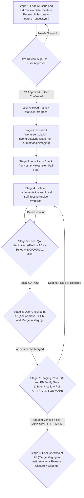

# UniVRse Workflow — Unified Cross-Harness Delivery Specification

> **Canonical Source of Truth**: This file (`AGENTS.md`) is the single source of truth for **OpenAI Codex** (`AGENTS.md`), **Claude Code** (`CLAUDE.md -> AGENTS.md`), and **Google Antigravity / Gemini CLI** (`GEMINI.md -> AGENTS.md`) operating inside `/Users/brendonang/Desktop/UniVRse workflow`.
>
> **Repo Domain Reference Preserved**: Repository-specific runtime rules, Hani/Hermes bridge constraints, Stark 1 Lock Sync rules, and SLA floors live in [`./UniVRse-2.0/CLAUDE.md`](./UniVRse-2.0/CLAUDE.md) (**Jarvis Operating Manual**) and MUST be honored alongside this delivery workflow.

---

## 1. Workspace Scope, Cross-Tool Compatibility & Domain Locks

### 1.1 Workspace & Primary Repository Layout
- **Workspace Root**: `/Users/brendonang/Desktop/UniVRse workflow`
- **Primary Repository**: `/Users/brendonang/Desktop/UniVRse workflow/UniVRse-2.0`
  - **Git Remote (`origin`)**: `https://github.com/UniVRse-Interactive/UniVRse-OS.git`
  - **Production Branch Note**: `origin/master` is currently the repository's production branch (`origin/HEAD -> origin/master`). The `staging` branch must be bootstrapped from `origin/master` (or `origin/main` once renamed) per Stage 2 before opening feature PRs.
- **Issue Tracking Policy**: **GitHub Issues ONLY** (`gh issue` CLI and GitHub MCP) on `UniVRse-Interactive/UniVRse-OS`. **No external issue trackers** exist in `UniVRse workflow`; all new features open under Milestone **`Feature Request`** using `.github/ISSUE_TEMPLATE/feature_request.yml`.

```text
/Users/brendonang/Desktop/UniVRse workflow/
├── AGENTS.md                        # Canonical cross-harness 8-stage delivery spec
├── CLAUDE.md -> AGENTS.md           # Relative symlink for Claude Code
├── GEMINI.md -> AGENTS.md           # Relative symlink for Google Antigravity / Gemini CLI
├── README.md                        # Workflow overview & installation guide
├── install.sh                       # Portable workspace installer & updater
├── univrse-workflow-diagram.png     # Visual 8-Stage Delivery Pipeline diagram
├── .gitignore                       # Ignores nested repos (UniVRse-2.0/), worktrees/, .env*
├── .mcp.json                        # Unified workspace MCP server definitions (slack, supabase)
├── .agents/
│   └── mcp_config.json              # Shared workspace MCP server config
├── .github/
│   └── ISSUE_TEMPLATE/
│       ├── config.yml               # Disables blank issues; links workflow docs
│       └── feature_request.yml      # Standardized Feature Request form (Milestone + PM Review)
└── UniVRse-2.0/                     # Primary repo (UniVRse-Interactive/UniVRse-OS.git)
    ├── CLAUDE.md                    # PRESERVED: Jarvis Operating Manual & Stark 1 Lock Sync
    ├── .env.example                 # Canonical list of environment keys (secrets in .env)
    ├── .gitignore                   # Must include worktrees/ (never commit worktrees or .env)
    ├── .github/ISSUE_TEMPLATE/      # Synced Feature Request Issue form & config
    ├── hermes/bridge/               # Hani-Hermes Python bridge (hani_bridge.py, link_ingest.py)
    ├── tools/                       # Python tools (gcal_direct.py, tenant_gate.py, etc.)
    ├── workflows/                   # Markdown SOPs & n8n workflow blueprints
    ├── tests/                       # Python test suites & smoke harnesses
    └── worktrees/                   # Gitignored isolated local worktrees (<type>-issue-<num>-<slug>)
```

### 1.2 Cross-Tool Compatibility (`CLAUDE.md`, `AGENTS.md`, `GEMINI.md`)
All three AI coding tools share this single canonical workflow specification through workspace root symlinks:

| Tool / Harness | Files Loaded Automatically | Resolution Behavior |
| :--- | :--- | :--- |
| **OpenAI Codex** | `AGENTS.md` (workspace root) | Loads this canonical 8-stage delivery pipeline directly; respects `./UniVRse-2.0/CLAUDE.md` when operating inside `UniVRse-2.0/`. |
| **Claude Code** | `CLAUDE.md` (`-> AGENTS.md`) + `UniVRse-2.0/CLAUDE.md` | Root `CLAUDE.md` symlink loads this canonical 8-stage delivery pipeline; `UniVRse-2.0/CLAUDE.md` appends repo-level domain locks. |
| **Google Antigravity / Gemini CLI** | `GEMINI.md` (`-> AGENTS.md`) + `AGENTS.md` | Both resolve to this single canonical file so identical pipeline rules, checkpoints, and domain locks apply across tools. |

### 1.3 Repo-Level Domain Reference (`./UniVRse-2.0/CLAUDE.md`)
Whenever working inside `UniVRse-2.0/`, tools MUST read and preserve [`./UniVRse-2.0/CLAUDE.md`](./UniVRse-2.0/CLAUDE.md) (**Jarvis Operating Manual with Stark 1 Lock Sync**). Do not overwrite or bypass these domain locks:

1. **Four-Lane Architecture**:
   - **STARK** (Strategy / Race Director), **JARVIS** (n8n logic, Hani's brain, RAG thresholds, workflow architecture), **ULTRON** (VPS chassis `207.148.76.194` / Tailscale `100.81.157.49`, Docker, Supabase SQL, cron, service restarts), **HANI ALYSSA** (runtime agent), and **HEZRI** (Team Principal / final decision maker).
2. **Hani / Hermes Bridge & Frozen Chassis Locks**:
   - **Hermes-only main brain pipeline (`run_brain()`)**: Primary service `hani-hermes-bridge.service` at `http://172.18.0.1:5057/hani`, `_call_hermes()` timeout cap `min(effective_timeout, 50)`, outer watchdog `55s`, no `openai_direct` or Claude fallback on the T0/T1 main pipeline (multi-tenant flow uses `_run_tenant_flow()` / `_call_openai_tenant()`).
   - **Frozen n8n chassis (`An5boYbCZW5BaPse`)**: 68-node base / 71 live nodes frozen per Stark directive. Do not add unauthorized n8n nodes; route new coordination hooks via the Python bridge or direct webhooks. Preserve `shortMessage` guard (`clean.length <= 80`), `isYes` regex, `[Hermes Hani]` prefix rule, Calendar direct bypass (`tools/gcal_direct.py`), and Drive rank filters (`_drive_name_score()`).
3. **N8N Lane Separation (CRITICAL)**:
   - **PROD lane**: `https://n8n-prod.univrse.io` (port `5679`, container `n8n-leaf`, WhatsApp `1gd6dLcn0Es21yNl`, Telegram `XN0H3Xu20vEs8TDI`).
   - **STAGING lane**: `https://n8n.univrse.io` (port `5678`, container `n8n`).
   - Never modify `/etc/nginx/sites-available/n8n` or `/etc/nginx/sites-available/n8n-prod` without explicit written directive from Stark AND Hezri.
4. **RAG Thresholds & SLA v2.1 Enforcement Locks**:
   - **Similarity thresholds**: General KB `0.65`, High-context `0.55`, Verification_Audit minimum `0.55`, `BLOCK_ALL_INFERENCE` `< 0.70`.
   - **SLA v2.1 latency floors**: Group A (Conversational) `4–7s`; Group B (KB Search bridge) `13.4s` (`16–19s` WA total); Group C (Email/Task/Delegation) `13.2s` ceiling (`~16–17s` WA total).
5. **Smoke Test Phone Protocol — ENFORCEMENT LOCKED**:
   - **ALL automated and manual internal smoke tests MUST use test phone `60000000001` exclusively.**
   - **Production line `60187777876` is strictly BANNED from any internal or automated test** (pollutes `sd.pendingHerHaniEmail` and `herhani_memory.json`).
6. **Precedence Rule**:
   - This root `AGENTS.md` governs the **End-to-End 8-Stage GitHub Issue -> Git Worktree -> `staging` -> `main` (`master`)** delivery pipeline across Claude Code, OpenAI Codex, and Google Antigravity (superseding raw direct pushes to `master`).
   - `./UniVRse-2.0/CLAUDE.md` governs all UniVRse runtime architecture, Hani/Hermes bridge behavior, thresholds, SLA floors, and smoke-test safety locks.

---

## 2. End-to-End 8-Stage Delivery Pipeline

All code, workflow, and infrastructure changes in `UniVRse-2.0` MUST follow this closed-loop 8-stage pipeline. No stage may be skipped.



### Stage 1: Feature Issue & PM Review Gate
- **Issue Tracking System**: **GitHub Issues ONLY** (`UniVRse-Interactive/UniVRse-OS` via `gh issue` / GitHub MCP). Every new feature MUST open a GitHub Issue assigned to Milestone **`Feature Request`** using `.github/ISSUE_TEMPLATE/feature_request.yml`.
- **Inspect Open Issues & Verify/Create `"Feature Request"` Milestone**:
  ```bash
  gh -R UniVRse-Interactive/UniVRse-OS issue list --limit 20
  gh -R UniVRse-Interactive/UniVRse-OS issue view <num> --comments

  gh api --paginate repos/UniVRse-Interactive/UniVRse-OS/milestones --jq '.[].title' | grep -qx "Feature Request" || \
    gh api repos/UniVRse-Interactive/UniVRse-OS/milestones -f title="Feature Request" \
      -f description="All new UniVRse feature requests gated by PM Review."
  ```
- **Create Feature Request Issue (`.github/ISSUE_TEMPLATE/feature_request.yml`)**:
  Open new features under Milestone **`Feature Request`** with labels `type:feature,status:pm-review` and all `.github/ISSUE_TEMPLATE/feature_request.yml` sections (**Problem Statement & Business Value**, **User Story**, **Gherkin Acceptance Criteria**, **Modified Fibonacci Estimate (Story Points)**, **Target Modules / Allowed Paths & Out of Scope**, and **PM Review & Delivery Gate Checklist**):
  ```bash
  gh -R UniVRse-Interactive/UniVRse-OS issue create \
    --title "[FEAT]: <concise feature summary>" \
    --milestone "Feature Request" \
    --label "type:feature,status:pm-review" \
    --body "### Problem Statement & Business Value
  <clear problem description & business impact>

  ### User Story
  As a <role>, I want <capability>, so that <benefit>.

  ### Gherkin Acceptance Criteria
  Scenario 1: Happy Path
    Given ...
    When ...
    Then ...

  Scenario 2: Validation / Error Handling
    Given ...
    When ...
    Then ...

  Scenario 3: Boundary / Tenant Isolation & 60000000001 Smoke Lock
    Given test phone 60000000001 (production line 60187777876 strictly excluded)
    When ...
    Then ...

  ### Modified Fibonacci Estimate (Story Points)
  <1 | 2 | 3 | 5 | 8 | 13 (Must split <= 8 at PM Review)>

  ### Target Modules / Allowed Paths & Out of Scope
  Target Modules / Allowed Paths:
  - TBD (Locked after Stage 1 PM Review Gate)

  Out of Scope:
  - <explicit exclusions>

  ### PM Review & Delivery Gate Checklist
  - [x] Assigned to Milestone: \"Feature Request\"
  - [ ] PM Review Gate completed (Gherkin ACs & Story Points <= 8 verified)
  - [ ] Stark 1 Lock Sync & Smoke Test Phone (60000000001) compliance verified
  - [ ] Allowed Paths contract defined for local Git Worktree
  - [ ] Stage 7 Staging CI + QA Verification + PM Staging Acceptance passed before Main merge"
  ```
  *(For non-feature bug fixes, chores, or hotfixes, inspect/open the GitHub Issue with `type:bug`, `type:chore`, or `type:hotfix`, define `Allowed Paths`, and apply `status:in-progress` directly.)*
- **Mandatory PM Review Checklist & Sign-Off -> User Checkpoint**:
  1. Verify Problem Statement & Business Value, User Story, Gherkin ACs (Happy Path, Validation/Error Handling, Boundary/Tenant Isolation & `60000000001` smoke lock), and Modified Fibonacci Story Points (`1, 2, 3, 5, 8`; any `13`-point item MUST be split into `<= 8` vertical slices before engineering begins).
  2. Post a structured **PM Review Sign-Off** comment on `#<Issue>` and transition `status:pm-review` -> `status:pm-approved`:
     ```bash
     gh -R UniVRse-Interactive/UniVRse-OS issue comment <num> --body "## PM Review Sign-Off
     - **Milestone**: Feature Request
     - **Story Points**: <1|2|3|5|8>
     - **Gherkin AC Verification**: Happy Path, Validation/Error Handling, Boundary/Tenant Isolation & 60000000001 smoke lock verified
     - **Decision**: Approved for Allowed Paths decomposition"
     gh -R UniVRse-Interactive/UniVRse-OS issue edit <num> --remove-label "status:pm-review" --add-label "status:pm-approved"
     ```
  3. **PAUSE FOR USER CHECKPOINT**: Stop at the **Stage 1 PM Review Gate** and obtain explicit **user confirmation** before locking `Allowed Paths`, setting `status:in-progress`, and creating the local git worktree.
- **Lock `Allowed Paths` & Transition to `status:in-progress`**:
  - Only after user confirmation at the PM Review Gate, document disjoint **`Allowed Paths`**, interface contracts, Stark 1 Lock impact, and verification commands on `#<Issue>`, then transition to `status:in-progress`:
    ```bash
    gh -R UniVRse-Interactive/UniVRse-OS issue edit <num> --remove-label "status:pm-approved" --add-label "status:in-progress"
    ```

### Stage 2: Local Git Worktree Isolation
- **Zero Direct Protected-Branch Edits**: NEVER edit, commit, or run code-generating tasks directly on `main`, `master`, or `staging`. The primary checkout `UniVRse-2.0/` MUST remain clean on its base branch.
- **Verify `.gitignore` Protection**: Confirm `worktrees/` is listed in `UniVRse-2.0/.gitignore` before creating any worktree:
  ```bash
  grep -n "worktrees/" "/Users/brendonang/Desktop/UniVRse workflow/UniVRse-2.0/.gitignore"
  ```
- **Fetch & Verify `origin/staging` (Bootstrap if Missing)**:
  ```bash
  cd "/Users/brendonang/Desktop/UniVRse workflow/UniVRse-2.0"
  git fetch origin
  git show-ref --verify refs/remotes/origin/staging
  ```
  - If `origin/staging` does **not** exist yet (e.g., `UniVRse-OS` currently uses `origin/master` as its production branch), ask user confirmation to bootstrap `staging` remotely before creating feature worktrees:
    ```bash
    # While UniVRse-OS uses origin/master as production branch:
    git checkout -b staging origin/master && git push -u origin staging
    # Or, once production branch is origin/main:
    git checkout -b staging origin/main && git push -u origin staging
    ```
- **Create the Isolated Worktree**:
  - Branch types `<type>` ∈ `feat`, `fix`, `refactor`, `chore`, `docs`, `test`, `hotfix` (`hotfix/*` branches from `origin/master` or `origin/main`; all normal work branches from `origin/staging`).
  - Check `git worktree list` first to avoid duplicate checkouts, then create inside `UniVRse-2.0/worktrees/`:
    ```bash
    git fetch origin
    git worktree list
    git worktree add worktrees/<type>-issue-<num>-<slug> -b <type>/issue-<num>-<slug> origin/staging
    ```

### Stage 3: `.env` Parity Check
- **Copy Untracked `.env`**: Copy `.env` from the primary checkout into the worktree root (NEVER commit `.env` to git):
  ```bash
  cp .env worktrees/<type>-issue-<num>-<slug>/.env
  ```
- **Parity Verification**: Verify `.env` exists in `worktrees/<type>-issue-<num>-<slug>/.env` and check that all required keys from `.env.example` are present and non-empty (without printing secret values):
  ```bash
  python3 - <<'EOF'
from pathlib import Path
wt = Path("worktrees/<type>-issue-<num>-<slug>")
env_file, ex_file = wt / ".env", wt / ".env.example"
assert env_file.is_file(), "FAIL-FAST: .env missing in worktree"
parse = lambda p: {
    l.split("=", 1)[0].strip(): l.split("=", 1)[1].split("#", 1)[0].strip()
    for l in p.read_text().splitlines()
    if l.strip() and not l.lstrip().startswith("#") and "=" in l
}
ex, env = parse(ex_file), parse(env_file)
missing = [k for k in ex if not env.get(k)]
print("Missing/empty keys vs .env.example:", missing)
EOF
  ```
- **Fail-Fast Hard Stop**: If `.env` is missing, or any required key in `.env.example` is missing or empty, **STOP immediately**, report the missing key names to the user, and do NOT proceed to builds or tests. *(Keys explicitly marked `# Optional` in `.env.example` may be waived only when the active task does not use that lane.)*

### Stage 4: Isolated Implementation & Local Self-Testing
- **Worktree & `Allowed Paths` Discipline**: All edits MUST occur strictly inside `worktrees/<type>-issue-<num>-<slug>` and strictly within the issue's locked `Allowed Paths`.
- **Local Self-Testing, Lint & Typecheck** (run inside `worktrees/<type>-issue-<num>-<slug>`):
  - Link ingestion & bridge unit tests:
    ```bash
    PYTHONPATH=. python3 -m unittest tests/test_link_full.py -v
    PYTHONPATH=. python3 -m unittest tests/test_link_typed.py -v
    ```
  - Pytest suite:
    ```bash
    PYTHONPATH=. python3 -m pytest -v
    ```
  - Lint / typecheck: Run any configured linter or typechecker (`ruff`, `flake8`, `mypy`, `npm run lint`, `npx tsc --noEmit`) for modified packages before advancing to Stage 5. *(Note: root `UniVRse-2.0/package.json` currently uses a placeholder `test` script; run Node/JS lint/typecheck/test targets inside packages/subdirectories that define real scripts.)*

### Stage 5: Local QA Verification
Execute a complete local verification pass inside `worktrees/<type>-issue-<num>-<slug>` prior to proposing any PR:
1. **Parity & Staging Check**: Re-verify `.env` parity and run `git -C worktrees/<type>-issue-<num>-<slug> status` to confirm zero `.env`, credential files, or out-of-scope edits are staged.
2. **Run Full Relevant Test Suites**:
   - `PYTHONPATH=. python3 -m unittest tests/test_link_full.py -v`
   - `PYTHONPATH=. python3 -m unittest tests/test_link_typed.py -v`
   - `PYTHONPATH=. python3 -m pytest -v`
   - `python3 tests/tenant_isolation_test.py` (when `SUPABASE_TENANT_CLIENT_DSN` is configured in `.env`)
   - `python3 tests/evaluation_matrix.py` (adversarial matrix — strictly uses `TEST_PHONE = "60000000001"`)
3. **Validate Gherkin Acceptance Criteria**: Verify every **Gherkin Acceptance Criterion** in `#<Issue>` (Happy Path, Validation/Error Handling, Boundary/Tenant Isolation).
4. **Enforce Smoke Test Phone & Domain Locks**: Confirm **smoke test phone `60000000001` only** is used across all tests, **`60187777876` is completely absent**, the frozen 68/71-node n8n chassis (`An5boYbCZW5BaPse`) is untouched unless Stark-ordered, and RAG thresholds (`0.65` / `0.55` / `< 0.70`) and SLA v2.1 floors are intact.
5. **QA Pass Criteria**: Proceed to Stage 6 only when all executed checks pass 100% after the final edit; otherwise return to Stage 4 to resolve defects and re-verify.

### Stage 6: User Checkpoint #1 — Ask Approval to Open PR & Merge to `staging`
- **Clean Conventional Commit**: Stage and commit verified changes inside the worktree using conventional prefixes (`feat:`, `fix:`, `chore:`, `sys:`, `docs:`, `test:`):
  ```bash
  git -C worktrees/<type>-issue-<num>-<slug> status
  git -C worktrees/<type>-issue-<num>-<slug> add <allowed-files>
  git -C worktrees/<type>-issue-<num>-<slug> commit -m "<type>(#<num>): <concise summary>"
  ```
- **MANDATORY USER CHECKPOINT #1**: Before pushing or opening any PR, present to the user:
  1. Branch name (`<type>/issue-<num>-<slug>`) & worktree path (`worktrees/<type>-issue-<num>-<slug>`),
  2. Changed files & concise diff summary,
  3. `.env` parity check status, and
  4. **Stage 5 Local QA Verification** commands & observed pass results.
  - **STOP and ask the user for explicit approval to push, open the PR, and merge to `staging`.**
- **Upon User Approval**:
  ```bash
  git -C worktrees/<type>-issue-<num>-<slug> push -u origin <type>/issue-<num>-<slug>
  gh -R UniVRse-Interactive/UniVRse-OS pr create \
    --base staging \
    --head <type>/issue-<num>-<slug> \
    --title "<type>(#<num>): <summary>" \
    --body "Refs #<num>\n\n## Summary\n...\n\n## Verification\n..."
  gh -R UniVRse-Interactive/UniVRse-OS pr checks <pr-num> --watch
  gh -R UniVRse-Interactive/UniVRse-OS pr merge <pr-num> --squash
  ```
  *(Use `--merge` instead of `--squash` if commit-level history is explicitly requested by the user.)*

### Stage 7: Staging Pass, QA & PM Verify Gate
- **Verify `staging` CI Pipeline**:
  ```bash
  gh -R UniVRse-Interactive/UniVRse-OS run list --branch staging --limit 5
  gh -R UniVRse-Interactive/UniVRse-OS run watch <run-id>
  ```
- **Verify Staging Endpoints (`https://n8n.univrse.io` / port `5678`)**:
  - Confirm the staging environment (`https://n8n.univrse.io`, port `5678`, and deployed staging endpoints) is healthy and running the merged `staging` build.
  - Run staging verification and smoke tests **strictly using test phone `60000000001` only — NEVER production line `60187777876`**.
  - Confirm latency stays within SLA v2.1 floors (Group A `4–7s`, Group B `13.4s`, Group C `13.2s` ceiling) and zero cross-tenant leaks occur.
  - Produce a **Staging Verification & Test Pass Report**.
- **PM Staging Sign-Off Gate (`[PM APPROVED FOR MAIN]`)**:
  - Audit the **Staging Verification & Test Pass Report** against every Gherkin Acceptance Criterion on `#<Issue>` (Happy Path, Validation/Error Handling, Boundary/Tenant Isolation & `60000000001` smoke lock).
  - **If Approved**: Post **`[PM APPROVED FOR MAIN]`** with AC-by-AC verification evidence on `#<Issue>` and update label to `status:staging-verified`:
    ```bash
    gh -R UniVRse-Interactive/UniVRse-OS issue comment <num> --body "[PM APPROVED FOR MAIN]
    Verified all Gherkin Acceptance Criteria against Staging CI and Staging Verification Report (60000000001 smoke lock intact)."
    gh -R UniVRse-Interactive/UniVRse-OS issue edit <num> --remove-label "status:in-progress" --add-label "status:staging-verified"
    ```
  - **If Rejected**: Post **`[PM REJECTED]`** citing exact unmet ACs and reproduction gaps on `#<Issue>`, keep `status:in-progress`, and return to Stage 4 remediation.
- **HARD GATE (Blocks Stage 8)**: Promotion from `staging` to `main` (`master`) is strictly **BLOCKED** unless ALL FOUR conditions are verified true:
  1. **`staging` CI passes** (all `gh run` checks green on `staging`),
  2. **Staging environment is verified healthy** (`https://n8n.univrse.io` / staging endpoints confirmed live & responsive),
  3. **All staging tests pass** with zero regressions and **`60000000001` only** (`60187777876` unused), AND
  4. **`[PM APPROVED FOR MAIN]`** is posted on `#<Issue>` with label `status:staging-verified`.

### Stage 8: User Checkpoint #2 — Ask Approval to Merge `staging` -> `main` (`master`), Close Issue & Cleanup Worktree
- **MANDATORY USER CHECKPOINT #2**: Present the **Staging Verification & Test Pass Report** (including `staging` CI run URL/status, staging endpoint health, and `60000000001` smoke test evidence) AND the **`[PM APPROVED FOR MAIN]`** sign-off, then **ask the user for explicit approval to merge `staging` into `main` (or `master`)**.
- **Upon User Approval — Open & Merge Release PR**:
  > **Branch Name Note**: Pass `--base master` while `UniVRse-Interactive/UniVRse-OS` still uses `master` as its default production branch; switch to `--base main` once the default branch is renamed to `main`.
  ```bash
  gh -R UniVRse-Interactive/UniVRse-OS pr create \
    --base master \
    --head staging \
    --title "release: merge verified staging (#<num>)" \
    --body "Closes #<num>\n\n## Staging Verification & Test Evidence\n..."
  gh -R UniVRse-Interactive/UniVRse-OS pr checks <release-pr-num> --watch
  gh -R UniVRse-Interactive/UniVRse-OS pr merge <release-pr-num> --merge
  ```
- **PM Release Closure & Close GitHub Issue (`status:done`)**:
  - After `staging` merges into `main` (`master`), update label to `status:done`, post the **PM Release Closure** summary on `#<Issue>` under Milestone **`Feature Request`**, and verify the issue is closed (closing explicitly if not auto-closed by `Closes #<num>`):
    ```bash
    gh -R UniVRse-Interactive/UniVRse-OS issue edit <num> --remove-label "status:staging-verified" --add-label "status:done"
    gh -R UniVRse-Interactive/UniVRse-OS issue close <num> \
      --comment "## PM Release Closure
    Verified on staging, approved for main, and released via Release PR #<release-pr-num> under Milestone Feature Request."
    ```
- **Clean Up Local Git Worktree**:
  ```bash
  cd "/Users/brendonang/Desktop/UniVRse workflow/UniVRse-2.0"
  git worktree remove worktrees/<type>-issue-<num>-<slug>
  git worktree prune
  ```
  *(Only delete local or remote feature branches with `git branch -d` / `git push origin --delete` after explicit user approval, and never pass `--force` to `git worktree remove` when uncommitted changes exist without asking first.)*

---

## 3. Universal Safety & Engineering Guardrails

- **Secrets Hygiene**: Never commit `.env`, `CONTEXT.md`, `token.json`, `gmail_token.json`, `credentials.json`, or API tokens. Never log or print secret values during Stage 3 `.env` parity checks.
- **Protected-Branch & Worktree Isolation**: Never edit or commit directly on `main`, `master`, or `staging`; always isolate changes in `worktrees/<type>-issue-<num>-<slug>`. Never execute destructive git commands (`git branch -D`, force pushes, `git worktree remove --force`) without explicit user approval.
- **No Unapproved Production Mutations**: Never deploy directly to `n8n-prod.univrse.io` (port `5679`), modify `/etc/nginx/sites-available/n8n*` without written directive from Stark AND Hezri, or run `60187777876` in tests; staging (`https://n8n.univrse.io`, port `5678`) + `60000000001` is mandatory prior to Stage 8 approval.
- **Strict User Checkpoints**: Always pause for explicit user confirmation at (1) Stage 1 PM Review Gate (`status:pm-approved`) before locking `Allowed Paths` and creating a worktree, (2) remote `staging` bootstrap when `origin/staging` does not exist yet, (3) Stage 6 User Checkpoint #1 before pushing/merging to `staging`, and (4) Stage 8 User Checkpoint #2 before merging `staging` into `main` (`master`).
- **Documentation & Comment Integrity**: Preserve all unrelated comments, docstrings, and domain records inside `./UniVRse-2.0/CLAUDE.md`.
- **Evidence-First Reporting**: Only claim file paths, symbol names, test runs, or verification passes that were directly observed after the final edit.

---

## 4. Portable Installation & Destination Setup (`install.sh`)

This workflow is packaged at `UniVRse-Interactive/UniVRse-workflow` and can be installed or updated into any destination folder via [`install.sh`](./install.sh):

- **Install or update into a target folder** (creates `CLAUDE.md -> AGENTS.md` and `GEMINI.md -> AGENTS.md` symlinks, copies `AGENTS.md`, `README.md`, `install.sh`, `.gitignore`, `.mcp.json`, `.agents/`, and `.github/`, and ensures `worktrees/` is present in nested repository `.gitignore` files with `.github/ISSUE_TEMPLATE/` synced):
  ```bash
  ./install.sh --dest "/path/to/your/folder"
  ```
- **Remote one-liner via `gh` CLI** (with optional `--with-repo` to clone `UniVRse-Interactive/UniVRse-OS` into `<dest>/UniVRse-2.0`, or `--repo <owner/name>` for any repository):
  ```bash
  bash <(gh api repos/UniVRse-Interactive/UniVRse-workflow/contents/install.sh -H "Accept: application/vnd.github.raw") --dest "/path/to/your/folder" --with-repo
  ```
- See [`README.md`](./README.md) for all installation options (remote `gh`, local clone, direct clone, and `curl`).
