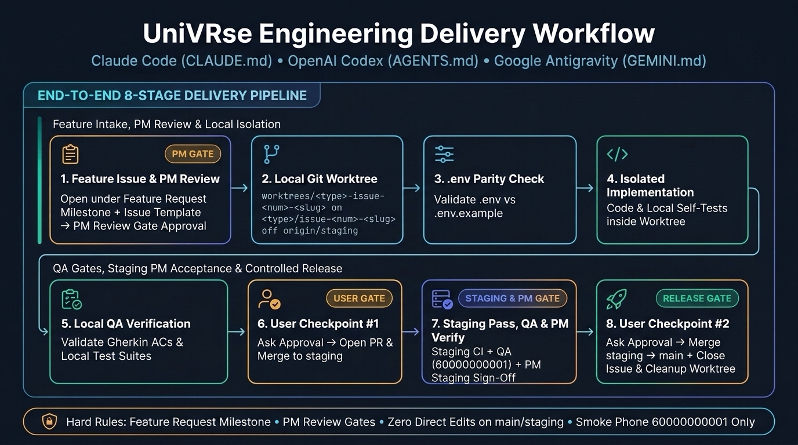

# UniVRse Engineering Delivery Workflow

Single-workflow **End-to-End 8-Stage Delivery Pipeline** standardized on `AGENTS.md` for **Claude Code** (`CLAUDE.md -> AGENTS.md`), **OpenAI Codex** (`AGENTS.md`), and **Antigravity CLI** (`GEMINI.md -> AGENTS.md`).



> **Stage 1: Intake & PM Review Gate** (`gh issue create --milestone "Feature Request"` / `status:pm-review` $\rightarrow$ `status:pm-approved`) $\rightarrow$ **Stage 2: Isolated Git Worktree** (`worktrees/<type>-issue-<num>-<slug>`) $\rightarrow$ **Stage 3: `.env` Parity & Docker Pre-Flight** $\rightarrow$ **Stage 4: Implementation & Local Self-Test** $\rightarrow$ **Stage 5: Independent QA Verification** $\rightarrow$ **Stage 6: User Checkpoint #1 (PR & Merge to `staging`)** $\rightarrow$ **Stage 7: Staging CI, QA Verify (`60000000001` Smoke Lock) & PM Staging Sign-Off (`[PM APPROVED FOR MAIN]`)** $\rightarrow$ **Stage 8: User Checkpoint #2 (Merge `staging` $\rightarrow$ `main`/`master`, Release Closure & Cleanup)**

---

## NPM Quick Start & Interactive Setup

Requires **Node.js `>= 18.0.0`** (zero third-party dependencies).

### Option A — Run Directly via `npx` from GitHub

```bash
npx github:UniVRse-Interactive/UniVRse-workflow
```

### Option B — Local Clone & `npm run setup`

```bash
git clone https://github.com/UniVRse-Interactive/UniVRse-workflow.git
cd UniVRse-workflow
npm install
npm run setup
```

### Option C — Non-Interactive CLI Flags

```bash
npx github:UniVRse-Interactive/UniVRse-workflow \
  --agent all \
  --role brendon \
  --dest "./UniVRse-2.0"
```

Supported CLI flags:
- `--agent <claude-code|codex|antigravity|all>`: Select the active coding agent (aliases: `claude`, `antigravity-cli`; default: `all`).
- `--role <hezri|asyraaf|brendon>`: Select the team member role profile injected into `AGENTS.md` (default: `brendon` in non-interactive mode).
- `-d`, `--dest`, `--project <path>`: Target `UniVRse OS` project directory (auto-detects `./UniVRse-2.0` or current `UniVRse-OS` checkout when omitted).
- `--with-repo`: Clone `UniVRse-Interactive/UniVRse-OS` into `<dest>` if missing.
- `--repo <owner/name>`: Clone an additional repository and ensure `worktrees/` is listed in its `.gitignore`.
- `-y`, `--yes`: Accept defaults non-interactively.
- `--postinstall`: Print NPM installation instructions and exit `0`.
- `-h`, `--help`: Display CLI usage help.

---

## Interactive Selections

### 1. Coding Agent Selection

| Option | CLI Flag | Entry Point Standardized |
| :--- | :--- | :--- |
| `1) Claude Code` | `--agent claude-code` | `CLAUDE.md -> AGENTS.md` |
| `2) OpenAI Codex` | `--agent codex` | `AGENTS.md` |
| `3) Antigravity CLI` | `--agent antigravity` | `GEMINI.md -> AGENTS.md` |
| `4) All` *(default)* | `--agent all` | `AGENTS.md`, `CLAUDE.md -> AGENTS.md`, `GEMINI.md -> AGENTS.md` |

### 2. Team Role Selection

| Option | CLI Flag | Stage 1–8 Focus |
| :--- | :--- | :--- |
| `1) Hezri (Project Owner)` | `--role hezri` | Stage 1 PM Review Gate (`status:pm-review` $\rightarrow$ `status:pm-approved`), Stage 6 & 8 User Checkpoints, Stage 7 `[PM APPROVED FOR MAIN]`, Stage 8 Release Closure |
| `2) Asyraaf (Frontend and Backend Engineer)` | `--role asyraaf` | Stage 2 Worktree Isolation (`worktrees/<type>-issue-<num>-<slug>`), Stage 3 `.env` Parity, Stage 4 Implementation & Self-Tests, Stage 5 QA (`60000000001`), Stage 6 Staging PR |
| `3) Brendon (Cloud Architect and DevOps Engineer)` | `--role brendon` | Stage 1/2 Tech Lead `Allowed Paths` & `staging` branch governance, Stage 3–7 VPS/Docker/n8n lane & CI compliance, Stage 8 Prod release & worktree cleanup |

---

## Standardization on `AGENTS.md` in `UniVRse OS`

When installed into your `UniVRse OS` project directory (`<dest>`, e.g., `UniVRse-2.0/`), the CLI standardizes all AI coding agents on **`AGENTS.md`** as the single canonical source of truth:

```text
<UniVRse-OS-project>/
├── AGENTS.md                           # Standardized 8-Stage Pipeline + Active UniVRse OS Operator Profile
├── CLAUDE.md -> AGENTS.md              # Relative symlink for Claude Code
├── GEMINI.md -> AGENTS.md              # Relative symlink for Antigravity CLI / Gemini CLI
├── docs/
│   └── UNIVRSE_OS_DOMAIN_MANUAL.md     # Preserved original repo CLAUDE.md domain manual (auto-migrated)
├── .univrse-workflow.json              # Active codingAgent, role, projectPath, symlinks, updatedAt
├── .mcp.json                           # Workspace MCP servers (copied if missing)
├── .agents/
│   └── mcp_config.json                 # Agent MCP config (copied if missing)
├── .github/
│   └── ISSUE_TEMPLATE/
│       ├── config.yml                  # Disables blank issues; links workflow guide
│       └── feature_request.yml         # Standardized Feature Request Issue Form (Milestone + PM Review)
└── .gitignore                          # Ensures worktrees/ and .univrse-workflow.json are ignored
```

> **Automatic Domain Manual Preservation**: If `<dest>/CLAUDE.md` exists as a regular file before installation (such as `UniVRse-2.0/CLAUDE.md`), `bin/cli.mjs` automatically backs it up to `<dest>/docs/UNIVRSE_OS_DOMAIN_MANUAL.md` before replacing `CLAUDE.md` with the relative symlink `CLAUDE.md -> AGENTS.md`, and references it inside the prepended **Active UniVRse OS Operator Profile** in `AGENTS.md`.

---

## Alternative Shell Installer (`install.sh`)

`./install.sh` automatically delegates to `bin/cli.mjs` whenever `node` (`>= 18`) is installed, and keeps a pure-bash fallback when Node.js is unavailable:

```bash
./install.sh --agent all --role brendon --dest "/path/to/UniVRse-2.0"
```

Or via remote one-liner (`gh` CLI / `curl`):

```bash
bash <(gh api repos/UniVRse-Interactive/UniVRse-workflow/contents/install.sh -H "Accept: application/vnd.github.raw") --dest "/path/to/your/folder" --with-repo
```

```bash
curl -fsSL https://raw.githubusercontent.com/UniVRse-Interactive/UniVRse-workflow/main/install.sh | bash -s -- --dest "/path/to/your/folder"
```

---

## Feature Request Milestone & PM Review Process

Every new feature request MUST use the standardized GitHub Issue Form at `.github/ISSUE_TEMPLATE/feature_request.yml` (blank issues are disabled via `.github/ISSUE_TEMPLATE/config.yml`) and be assigned to the **`Feature Request`** Milestone:

```bash
gh issue create \
  --milestone "Feature Request" \
  --label "type:feature,status:pm-review" \
  --title "[FEAT]: <concise feature title>" \
  --body-file <structured-feature-body.md>
```

### PM Review & Checkpoint Gates

1. **Stage 1 — Intake & PM Review Gate (`status:pm-review` $\rightarrow$ `status:pm-approved`)**:
   - New feature issues enter with `type:feature` and `status:pm-review` under the **`Feature Request`** Milestone.
   - PM reviews business value, refines the User Story and Gherkin Acceptance Criteria (Happy Path, Validation/Error Handling, Boundary/Tenant Isolation & `60000000001` Smoke Lock), and verifies Modified Fibonacci Story Points (`<= 8`; `13`-point requests MUST be split before engineering starts).
   - Once approved, swap `status:pm-review` $\rightarrow$ `status:pm-approved` and proceed to **Stage 2 — Worktree** (`worktrees/<type>-issue-<num>-<slug>`).
2. **Stage 6 — Staging PR Checkpoint (User Checkpoint #1)**:
   - After `.env` parity, local implementation, self-tests, and independent QA sign-off pass, ask for explicit user approval before opening/merging the PR into `staging`.
3. **Stage 7 — Staging Verify & PM Staging Sign-Off (`[PM APPROVED FOR MAIN]`)**:
   - After PR merge to `staging`, Staging CI passes, and staging QA verification completes using test phone `60000000001`, PM validates all Gherkin ACs on Staging and posts **`[PM APPROVED FOR MAIN]`** before **User Checkpoint #2**.
4. **Stage 8 — Main Release Checkpoint (User Checkpoint #2) & Release Closure**:
   - Ask for explicit user approval before merging `staging` $\rightarrow$ `main`/`master`; once production deploy succeeds, record release notes, close the `Feature Request` Milestone issue with a release summary comment, and clean up the worktree/branch.

---

## Core Safety & Domain Locks (`docs/UNIVRSE_OS_DOMAIN_MANUAL.md` / `UniVRse-2.0/CLAUDE.md`)

- **GitHub Issues & Feature Request Milestone Only**: All tasks are tracked via GitHub Issues (`gh issue` / GitHub MCP), with new features routed through the **`Feature Request`** Milestone and `.github/ISSUE_TEMPLATE/feature_request.yml`.
- **Smoke Test Phone Lock**: All internal and staging smoke tests MUST use test phone `60000000001` exclusively — production line `60187777876` is strictly banned from tests.
- **Worktree & Branch Isolation**: Never commit directly to `main`, `master`, or `staging`; always develop in `worktrees/<type>-issue-<num>-<slug>` on `<type>/issue-<num>-<slug>`.
- **Two Mandatory User Checkpoints**: Always ask user approval before merging to `staging` (Checkpoint #1) and before merging `staging` to `main`/`master` (Checkpoint #2, after `[PM APPROVED FOR MAIN]`).
